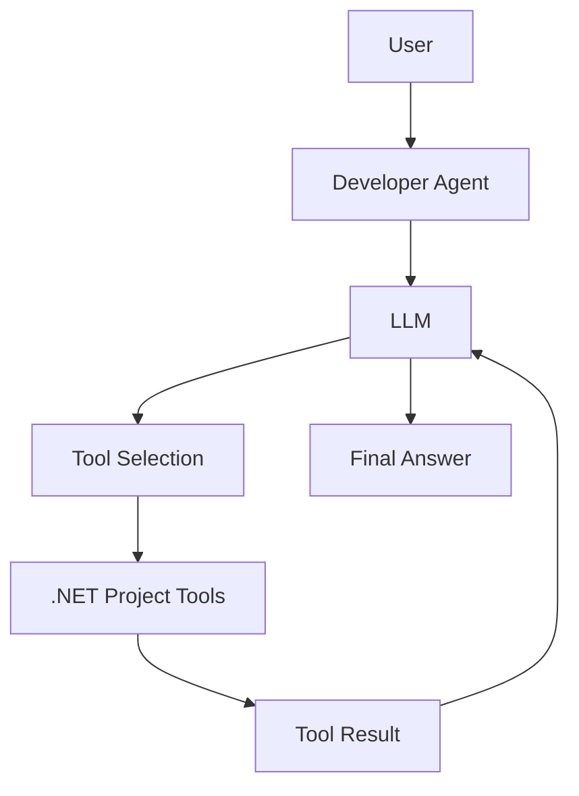

# DotnetAgentDemo

Console application didática para mostrar, com o mesmo modelo, a diferença entre uma chamada LLM e um Agent que pode escolher e executar ferramentas C#.

## Objetivo

Demonstrar o fluxo **LLM → Agent → Instructions → Tools → Action → Result** sem adicionar frontend, API, banco de dados ou arquitetura além do necessário para a explicação.

## Arquitetura



O Agent Framework envia ao modelo as instructions e os metadados das ferramentas. O modelo escolhe uma função quando precisa de informação; o framework invoca a função C# e devolve seu resultado ao modelo. A aplicação não interpreta o texto da pergunta para escolher ferramentas.

## Requisitos

- .NET SDK 10
- Uma API key da OpenAI e acesso a um modelo compatível com Chat Completions e function calling

## Pacotes NuGet

Aplicação principal:

- `Microsoft.Agents.AI.OpenAI` 1.23.0: integra o Microsoft Agent Framework ao cliente OpenAI.
- `Microsoft.Extensions.AI.OpenAI` 10.10.1: adapta o cliente OpenAI a `IChatClient`, usado tanto na chamada direta quanto no Agent.
- `Microsoft.Extensions.Configuration.Json` 10.0.12: lê o `appsettings.json`.
- `Microsoft.Extensions.Configuration.UserSecrets` 10.0.12: lê a API key do armazenamento local de User Secrets.
- `Microsoft.Extensions.Configuration.EnvironmentVariables` 10.0.12: permite sobrescrever configuração por variáveis de ambiente.

O `SampleProject` inclui referências de exemplo a `Microsoft.Extensions.Http.Resilience`, `Polly` e `Serilog.Extensions.Logging`. Elas são apenas dados para a tool demonstrar a leitura de dependências; o Agent não instala nem executa essas bibliotecas.

## Configuração

Na pasta do projeto, armazene a chave localmente com User Secrets:

```bash
dotnet user-secrets init
dotnet user-secrets set "AI:ApiKey" "SUA_API_KEY"
```

O projeto já contém um `UserSecretsId`; por isso, `init` pode informar que ele já está configurado. Nesse caso, execute diretamente o comando `set`. A chave não fica em `appsettings.json` nem no código. O modelo pode ser alterado em `appsettings.json` ou sobrescrito com `AI__Model`.

## Como executar

```bash
dotnet run
```

Escolha `1` para chamar o LLM sem Agent ou `2` para conversar com o `DeveloperAgent`. Digite `exit` no prompt para voltar ao menu e `exit` no menu para encerrar.

## LLM e Agent

No modo LLM, a aplicação envia somente a pergunta ao `IChatClient`. O modelo responde com o contexto que recebeu e não tem acesso às ferramentas deste projeto.

No modo Agent, o modelo também recebe as instructions do `DeveloperAgent` e três ferramentas. Quando o modelo solicitar uma delas, o Agent Framework chama a função C# e inclui o resultado na conversa para que o modelo formule a resposta. O uso de ferramentas continua dependendo da decisão do modelo; não há regra baseada em palavras da pergunta.

## Tools disponíveis

- `GetDotnetVersion`: executa `dotnet --version` e retorna a versão instalada do SDK.
- `GetProjectInfo`: lê o TargetFramework, o nome e o tipo do `SampleProject`.
- `GetProjectDependencies`: lê os `PackageReference` do arquivo `.csproj` de exemplo.

As descrições que acompanham as funções ajudam o modelo a entender quando cada uma é apropriada. Cada função escreve no terminal sua seleção, início e resultado resumido. A chave de API não é registrada. A resposta final também é mostrada pelo console.

## Exemplo de execução

```text
1 - Perguntar ao LLM
2 - Perguntar ao AI Agent
exit - Encerrar
Selecione: 2

Pergunta (exit volta ao menu):
> Analyze this .NET project and tell me if there is anything I should pay attention to.

[AGENT] Analisando a pergunta...
[TOOL CALLED] GetProjectInfo
[TOOL] Lendo o arquivo SampleProject.csproj...
[TOOL RESULT] SampleProject | net10.0 | Console application
[TOOL CALLED] GetProjectDependencies
[TOOL] Lendo os PackageReferences do projeto...
[TOOL RESULT] 3 dependência(s): ...

AGENT:
...
```

A seleção e a ordem das tools podem variar conforme o modelo e a pergunta. A versão do SDK só precisa ser consultada quando for relevante à análise.

## Estrutura

```text
DotnetAgentDemo/
├── Program.cs
├── DotnetAgentDemo.csproj
├── Agents/
│   └── DeveloperAgent.cs
├── Tools/
│   ├── DotnetTools.cs
│   └── ProjectTools.cs
├── Models/
│   └── ProjectInfo.cs
├── SampleProject/
│   ├── Program.cs
│   └── SampleProject.csproj
├── appsettings.json
├── .gitignore
└── README.md
```

## Evolução dos commits para o vídeo

O workspace contém o estado final. Para gravar a evolução, crie os commits em sequência, apresentando em cada etapa os arquivos indicados:

- `00-start` — estrutura mínima de console: `DotnetAgentDemo.csproj`, `Program.cs`, `appsettings.json` e `.gitignore`.
- `01-llm` — chamada direta ao modelo em `Program.cs`, configuração de User Secrets e os pacotes de cliente/configuração no `.csproj`.
- `02-agent` — `Agents/DeveloperAgent.cs` e a troca entre chamada simples e `AIAgent` no `Program.cs`.
- `03-tools` — `Tools/DotnetTools.cs`, `Tools/ProjectTools.cs`, `Models/ProjectInfo.cs` e `SampleProject/`.
- `04-demo` — menu interativo, logs visíveis, tratamento de erros sem expor dados sensíveis e documentação final em `README.md`.

## Escopo e próximos passos

O projeto não implementa RAG, MCP, múltiplos agentes, memória persistente, build/testes automatizados ou escrita de código. A estrutura de tools permite acrescentar essas capacidades em episódios posteriores sem introduzir agora padrões arquiteturais desnecessários.